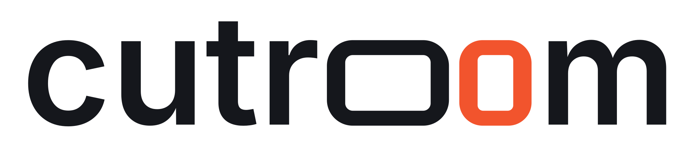

<h1 align="center">
  <picture>
    <source media="(prefers-color-scheme: dark)" srcset="docs/brand/cutroom-wordmark-reversed.svg">
    
  </picture>
</h1>

<p align="center">A local-first video editing studio for Hermes Agent.</p>

Cutroom turns a local recording into a reviewable edit: word-timed transcript cuts and filler review, silence removal, face/gaze/mouth review, person segmentation for graphics behind the subject, three source-quoted hook options with a storyboard, a preview render, a human-approved final export, a cover and automated quality checks. Media and models stay on your machine, and source files are never overwritten.

It ships three surfaces:

- **Hermes Desktop Studio page** — import, edit words, captions and ranges, pick a hook, choose a platform profile, create platform versions, run jobs, play previews with an optional safe-zone overlay, review the exact digest and approve the final export.
- **Agent tools** — `cutroom_project` and `cutroom_job` let Hermes create projects, edit settings and run allowlisted background jobs. There is no approval tool: only a person can approve a final export.
- **CLI** — `cutroom doctor`, `cutroom setup-models` and the plan-file commands below.

See the [documentation index](docs/README.md), [Studio jobs](docs/studio-jobs.md) and [current status](docs/status.md) for exact contracts and limits.

## Studio workflow

1. `transcribe` (local faster-whisper) → review fillers and exclude words.
2. `silence` → trims pauses while preserving manual cuts.
3. `storyboard` → three hook options quoted from the transcript; choose one, run again for scenes.
4. `vision` (MediaPipe face landmarks) → review-only gaze/mouth intervals. `segment` → person layer to place graphics or a background behind the subject.
5. `preview` → a fast render with word-timed captions (classic, highlighted word, pop-in words or one large word at a time) and SRT/VTT sidecars.
6. Human review and approval of the exact digest in the Desktop Studio page.
7. `final`, `cover`, `qa` (resolution, decode, black/freeze frames, timing, loudness, clipping, captions, safe area; platform frame, length, frame rate, upscaling, loudness and safe zone for platform projects).

**Delivery package** in Export makes a local per-platform folder from an approved final with video, cover, bounded post text and verifiable checksums; nothing is posted.

Every job is bound to the project revision and its input files. Edits revoke approval and unlink stale renders; published files carry SHA-256 lineage.

## Platform formats

A project renders for one platform profile, or for `custom` (the original behaviour: frame from the aspect setting, −16 LUFS, no platform checks). Choose the profile in the Studio settings (`settings.platform`, plus `settings.final_resolution` `"1080"` or `"2160"`). To deliver the same edit elsewhere, create a **version**: a sibling project that copies the transcript, cuts, story and brand but has its own settings, review digest and human approval.

| Profile | Frame (default final; 4K opt-in) | Length | Safe zone top / bottom / left / right |
|---|---|---|---|
| `instagram_reels` | 1080×1920; 2160×3840 | ≤ 20 min, warning above 3 min | 14 / 35 / 6 / 6 % |
| `youtube_shorts` | 1080×1920; 2160×3840 | ≤ 3 min | 15 / 35 / 5 / 18 % |
| `tiktok` | 1080×1920; 2160×3840 | ≤ 60 min | 13 / 35 / 12 / 28 % |
| `youtube` | 1920×1080; 3840×2160 | no limit | 5 % each side |

Every profile targets −14 LUFS and −1 dBTP. The frame sizes are Cutroom's choice within each platform's published rule. Titles, lower thirds and burned captions (at most two lines per event) are placed inside the safe zone, and QA adds frame, length, frame-rate, upscaling, loudness and safe-zone checks for the profile. A final export longer than the profile's limit is refused. Burned captions can be classic, highlight the spoken word, pop words in or show one large word at a time; each word starts and ends within one frame of its timestamp, which QA checks. YouTube versions get SRT/VTT sidecars, and burning captions in is opt-in. Optional local music is ducked under speech, faded and looped; a cut sound can mark each cut; voice clean-up reduces hum and hiss; the mix is normalised to the platform target, and QA measures ducking depth and loudness. Optional pacing adds punch-ins on cuts centred on the face (never enlarging the source past a set limit), shortens long pauses and puts crossfades or dips on cuts. Long YouTube videos get chapters that follow YouTube's rules (suggested from the transcript, embedded and written as description text), a sentence-based SRT, a 16:9 thumbnail under 2 MB and optional end-screen room. Each value cites its source in `cutroom/platforms.py`; choices and open items are in [creator formats](docs/creator-formats.md).

**Find clips** in Edit turns long recordings into scored, sentence-bounded 20–90 s suggestions; **Make clip** opens a separate platform project limited to that source range, with its own review and approval.

## Models

Nothing is downloaded automatically. `cutroom setup-models DIR` prints the pinned URLs and SHA-256 values; add `--confirm-downloads` to fetch them over HTTPS with size limits and no-overwrite installation. `cutroom doctor --models-dir DIR` checks FFmpeg, the runtime interpreter, optional packages and model hashes. Advanced modules need the optional Python dependencies described in [development setup](docs/development.md).

## Plan-file core

The original plan-file workflow remains available for simple silence edits.

## Requirements

- Hermes Agent 0.23.0 or later for native tool registration.
- Python 3.11+.
- `ffmpeg` and `ffprobe` in PATH, with `libx264` and AAC encoding support.
- A local video file. The core needs no API keys or Python runtime dependencies; advanced modules use the optional environments described in [development setup](docs/development.md).
- An output filesystem with hard-link support (for example NTFS or ext4), used for atomic no-overwrite publication. FAT/exFAT outputs are not currently supported.

Verified on native Windows with FFmpeg 9.0.2; CI runs the test suite on Windows and Ubuntu.

## Quick start

From this checkout:

```bash
python -m cutroom inspect /absolute/path/recording.mp4
python -m cutroom draft /absolute/path/recording.mp4 /absolute/path/new-project
```

Open `new-project/review.html` in your local browser. It shows the source, a keep/remove timeline, and the source-time ranges to retain. This is a plan review, not a rendered edited-video preview. Listen around every proposed cut.

The draft is editable JSON. After changing `plan.json`, regenerate its review:

```bash
python -m cutroom review /absolute/path/new-project/plan.json
```

The review prints an exact digest. Confirm it from your terminal:

```bash
python -m cutroom approve /absolute/path/new-project/plan.json --digest <reviewed-digest>
python -m cutroom render /absolute/path/new-project/plan.json
```

The result is `new-project/render.mp4`. Existing outputs are rejected rather than overwritten. A changed plan or source invalidates the approval. Create a fresh project for another export in this initial version.

Optional installation as a standalone CLI: `python -m pip install .` using the same Python interpreter as your environment. No installation is needed for the commands above.

## Hermes plugin

The root `plugin.yaml` and `__init__.py` implement the documented native plugin contract. Validate this directory with:

```bash
hermes plugins doctor /absolute/path/hermes-cutroom --ci
hermes plugins validate /absolute/path/hermes-cutroom --install-deps
```

For local development, link this directory as `<active-HERMES_HOME>/plugins/cutroom`, then explicitly enable `cutroom` using `hermes plugins enable cutroom`. Installing/enabling modifies the active profile; this checkout does not do that automatically.

By default chat gets three tools:

| Tool | Behavior |
| --- | --- |
| `cutroom_inspect` | Read media dimensions, duration and audio availability |
| `cutroom_project` | Create, list, read, update, review and derive platform versions of Studio projects (no approval) |
| `cutroom_job` | Submit, list, read and cancel allowlisted Studio jobs; completed previews, finals and covers carry a `media` summary |

The older plan-file tools are hidden from chat unless you opt in, because they overlap with the Studio tools. They stay available in the `python -m cutroom` CLI. To offer them in chat as well, set the plugin setting `legacy_tools: true` (`plugins.entries.cutroom.settings.legacy_tools` in the Hermes config) or start Hermes with `CUTROOM_LEGACY_TOOLS=1`:

| Tool (opt-in) | Behavior |
| --- | --- |
| `cutroom_draft` | Detect silence, preserve configurable padding, save an editable plan and local HTML review in a new directory inside the Cutroom workspace |
| `cutroom_review` | Regenerate review and digest after plan edits; refuses plans outside the workspace and any `review.html` Cutroom did not write |
| `cutroom_render` | Render an approved plan inside the workspace; reject stale approval and existing output |

The plugin also bundles the skill `cutroom:edit-video` (`skills/edit-video/SKILL.md`), which sets out the chat workflow. Hosts without plugin skills still load the tools.

Agent tools write only inside the Cutroom workspace (`CUTROOM_WORKSPACE`, otherwise Hermes' plugin data directory for `cutroom`); the legacy plan tools use its `plans/` subdirectory. The user-run `python -m cutroom` CLI keeps writing where you point it.

There is deliberately **no approval tool**. Show the draft to the user and let them confirm locally. Receipts are an accidental-stale-render guard, **not** an authenticated approval mechanism: another program with filesystem access can write receipts. Do not describe them as a security sandbox.

## Using Cutroom from chat

Ask for the edit in plain words and give a local path. The `cutroom:edit-video` skill walks through import, transcription, cuts, platform, captions, framing, preview and QA, then hands approval to you in Cutroom Studio. Nothing is uploaded or published.

Example conversation:

> **You:** Turn C:/Videos/talk.mp4 into an Instagram Reel with highlighted captions.
>
> **Hermes:** Imported "talk" (4:12). Transcribing, 40 %… done. I suggest cutting 14 pauses over 0.6 s, the repeated intro and the aside about parking (about 1:05 in total), which brings it to 2:41. Apply these cuts?
>
> **You:** Yes, but keep the parking joke.
>
> **Hermes:** Done: Reels format, highlighted captions, blurred background to fill the vertical frame. Here is the preview:
>
> `MEDIA:C:\Users\you\AppData\Local\hermes\plugins\cutroom\jobs\…\outputs\preview.mp4`
>
> It is ready with one note: the picture was enlarged from a smaller source, so it may look slightly softer. Anything to change? When you are happy, review and approve it in Cutroom Studio, and I will export the final.
>
> **You:** I approved it in Studio. Also make a YouTube Shorts version.
>
> **Hermes:** Final exported (`MEDIA:…\final.mp4`). I created a Shorts version; it starts unapproved, so it needs its own preview and approval.

In Hermes Desktop the `MEDIA:` line becomes a Cutroom card with the player, QA status and buttons to open the project in Studio. Other surfaces show their standard player for the same file. Only you can approve, and only in Cutroom Studio or the local REST API; the chat tools cannot approve and the final export is refused if the edit changed after approval.

## Editing semantics

- Silence threshold: -35 dB, minimum silence: 0.5 seconds, speech-side padding: 0.12 seconds by default.
- Cuts use source timestamps, not word boundaries. Silence detection cannot distinguish hesitation from intentional pauses.
- No-audio video keeps its full duration.
- Audio/video are trimmed together and re-encoded to H.264/AAC MP4. This is not lossless editing.
- Only the selected primary video/audio streams are used; extra tracks, chapters and subtitle tracks are not a preservation feature.
- Path-based local media only; URL/network imports are out of scope.
- Each run creates a separate directory. Plan and SHA-256 source fingerprints make accidental changes detectable.

## Data and permissions

The plugin reads the video path explicitly supplied, launches local FFmpeg/ffprobe subprocesses, and writes only inside its workspace (agent tools) or the directory you pass to the CLI.

Child processes receive a minimal allowlisted environment (executable lookup, home/temp directories, locale, fonts and `CUTROOM_*` settings); provider API keys and other tokens in the Hermes process are not forwarded. Consented rclone/yt-dlp commands additionally receive `RCLONE_*`, proxy and CA-bundle variables. Native-model workers run under `CUTROOM_PYTHON` if you set it, otherwise the plugin's bundled `.venv`, otherwise Hermes' interpreter; projects, the Desktop page and agent tools cannot choose an executable. It does not send media anywhere, read credential stores, update itself, alter Hermes core, or attach global hooks. FFmpeg is an external executable the user supplies. A malicious media file can exploit a vulnerable decoder: use a maintained FFmpeg build and only process trusted files. Local protocols are restricted; this is defense in depth, not an OS sandbox.

## Current boundaries

Hooks, storyboards and captions are extractive drafts from your own transcript, not generated writing. Gaze is a heuristic for review, not an automatic cut. Background separation uses MediaPipe person segmentation, not SAM. Optional download, OBS, rclone and calendar adapters are consent-gated and not part of the Studio pipeline; they have not been accepted against live services. Verified primarily on Windows. See [current status](docs/status.md) and [remaining work](docs/roadmap.md).

## Tests

```bash
python -m unittest discover -s tests -v
```

Media tests generate clearly identified synthetic tone/color fixtures and run real FFmpeg/ffprobe. Synthetic fixtures test mechanics; they are not evidence of quality on real speech. Use a consented recording to assess editorial quality.

## License

MIT. FFmpeg is supplied separately and has its own license obligations.
