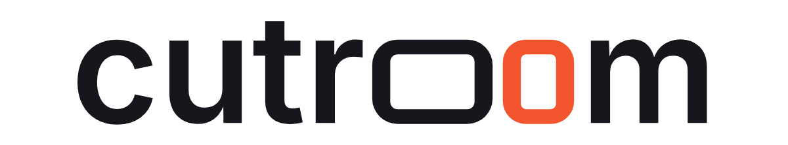

# Cutroom brand

The name is set in lowercase. The two o's are video frames: a landscape
frame, then a portrait one. Cutroom reframes a recording for every screen,
and the logo says it in the name itself.

## Files

| File | Use |
|---|---|
| `cutroom-wordmark.svg` | Main logo on light backgrounds |
| `cutroom-wordmark-reversed.svg` | Main logo on dark backgrounds |
| `cutroom-wordmark-black.svg`, `cutroom-wordmark-white.svg` | One colour: print, stamps, single-colour overlays |
| `cutroom-symbol.svg` (+ `-black`, `-white`) | The two frames alone, where the name is already shown nearby |
| `cutroom-app-icon.svg`, `png/cutroom-app-icon-*.png` | App and avatar tile |
| `cutroom-favicon.svg`, `favicon.ico`, `png/cutroom-favicon-*.png` | Browser tabs and 16–48 px places |
| `png/cutroom-banner-1200x600.png` | Catalog card and social preview (2:1) |

All SVG files are outlines: no fonts, strokes, filters or images are needed.

## Colour

| Name | HEX | RGB | Use |
|---|---|---|---|
| Ink | `#15171C` | 21 23 28 | Letters, landscape frame, app-icon tile |
| Cut orange | `#F2542D` | 242 84 45 | Portrait frame only |
| Paper | `#FFFFFF` | 255 255 255 | Letters on dark backgrounds |

Contrast: ink on paper 17.9:1; cut orange on paper 3.5:1 and on ink 5.2:1.
Cut orange passes the 3:1 contrast for graphics, not the 4.5:1 for body text,
so do not set running text in it.

Inside Hermes Desktop the wordmark follows the app's theme: letters take the
text colour and the portrait frame takes the app accent, like every other
highlight in the app.

## Spacing and size

- Clear space: keep at least the height of the o's free on every side.
- Smallest wordmark: 72 px wide on screen, 20 mm in print. Below that use the
  symbol or the favicon.
- The symbol reads down to 16 px; the favicon keeps less padding for that.

## Do not

- Recolour the frames separately, add a third colour, gradients or shadows.
- Stretch, rotate, outline or re-space the letters.
- Replace the frames with ordinary o's, or the letters with another typeface.
- Put the colour version on a busy photo; use the white one-colour version.

## Construction

Letters c, u, t, r and m are Inter 4.1 SemiBold, converted to outlines. Inter
is licensed under the SIL Open Font License 1.1 (`INTER-LICENSE.txt`), which
allows this use. The frames are drawn to match it: their height is Inter's
x-height plus its overshoot, vertical strokes match the letter stems, and
horizontal strokes are 0.82 of them, as in Inter's own o. The landscape frame is
1.42 times as wide as it is tall; the portrait frame is 0.84.

A trademark search has not been made.
